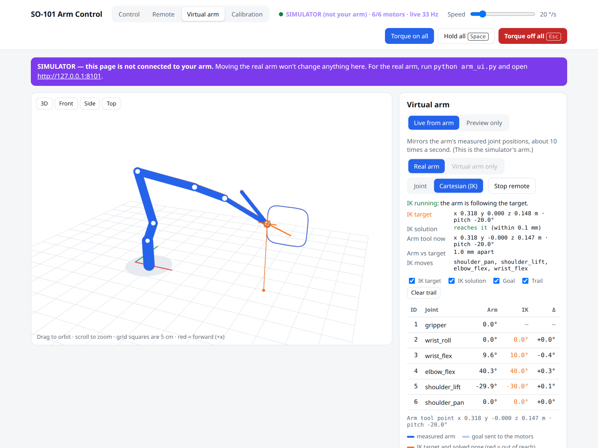
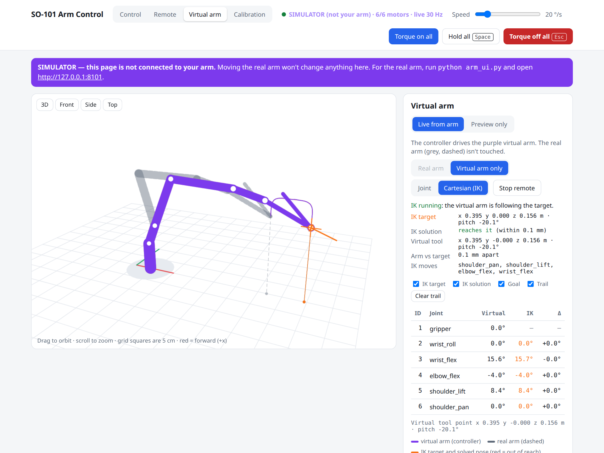
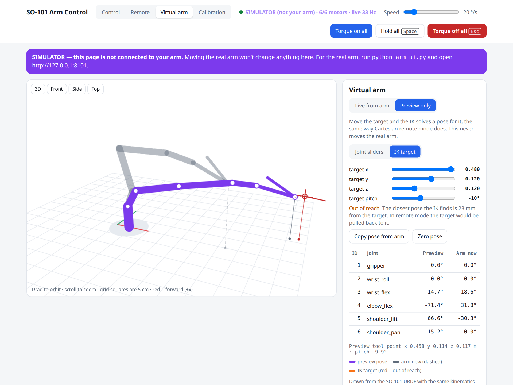

# Roma: SO-101 follower arm tools

Small Python tools for bringing up a standalone **SO-101 follower arm** (the [TheRobotStudio SO-ARM100](https://github.com/TheRobotStudio/SO-ARM100) design, six Feetech STS3215 servos): scan, number and calibrate the motors, drive them from a browser panel, and control the arm with a PlayStation controller, including Cartesian (IK) control.

It is the groundwork before moving to [LeRobot](https://github.com/huggingface/lerobot) for recording data and training policies. The core needs only `pyserial`; there is no Feetech SDK.

> **Status:** used on one real arm (Windows 11). Scanning, ID setup and calibration have run on the hardware. The PS4 remote mode was tested against a simulator and with a real controller's button mapping, but has **not yet moved the real arm**. Treat it as untested hardware software and start slowly.

## Hardware

- SO-101 arm: 6 × Feetech STS3215 on one daisy-chained half-duplex bus, 1,000,000 baud.
- Waveshare Bus Servo Adapter (A) (CH343 USB serial). The jumper must be in position **A**; in B the servos go silent. USB only powers the serial chip: servo power comes from the board's DC input.
- Servo supply **5–7.4 V**, never above about 8.4 V, with at least 5 A for the whole arm. The tools refuse to move anything above 8.4 V.
- Optional: a DualShock 4 for remote control.

The author's arm uses the 1:147 (C046) STS3215, which is faster but has much less torque than the standard 1:345 (C001). Expect the shoulder and elbow to sag or stall under gravity. The code is the same for both: the encoder is on the output shaft, 4096 steps per turn.

### Joint IDs

The motors are numbered **gripper → base**, which is the **reverse** of stock LeRobot's `so101_follower` (shoulder_pan = 1 … gripper = 6):

| ID | Joint |
|---|---|
| 1 | gripper |
| 2 | wrist_roll |
| 3 | wrist_flex |
| 4 | elbow_flex |
| 5 | shoulder_lift |
| 6 | shoulder_pan |

The map lives in `JOINTS` in `sts_bus.py` and `scan_servos.py` (keep them in sync). Renumber the motors with `so101_setup_ids.py` if you want LeRobot's order, and change `JOINTS` to match.

## Install

```powershell
pip install -r requirements.txt
```

Python 3.9+ (developed on 3.11). `pygame` is only needed for the controller.

The scripts auto-detect the adapter by its USB vendor ID, so you normally don't pass a port. Only one program can own the serial port at a time, so close the web panel before running a standalone script.

## Quick start

```powershell
python scan_servos.py        # read-only: lists every servo, voltage, temperature, load. Run this first.
python arm_ui.py             # web control panel at http://127.0.0.1:8101
python arm_ui.py --sim       # same UI with a simulated arm, no hardware (port 8101)
```

## What's in here

| File | What it does |
|---|---|
| `scan_servos.py` | Read-only scan of IDs 0–253; flags missing and misnumbered joints. |
| `so101_scan.py` | Read-only status, or a live joint readout with `--watch`. |
| `so101_setup_ids.py` | Write motor IDs (single change, one joint, all, or identify by wiggling). Swaps through temporary IDs so two motors never share one. Asks for `YES` before writing. |
| `so101_calibrate.py` | Command-line calibration like `lerobot-calibrate`. Writes LeRobot-format JSON. |
| `joint_limits.py` | Read-only: design limits vs each motor's limit window; `--measure` records real ranges by hand. |
| `test_servos.py` | Nudges each servo and back, one at a time, and reports OK / STALLED / FAIL from the measured position. |
| `arm_ui.py` + `arm_ui.html` | Local web panel: per-joint torque, sliders, jog buttons, live load/temperature/voltage, calibration wizard, remote tab, virtual 3D arm (`#virtual`). |
| `remote.py` | PS4 controller control (used by the panel). |
| `kinematics.py` | Forward kinematics and damped-least-squares IK from the SO-101 URDF geometry. |
| `pad_check.py`, `dir_check.py` | Read-only helpers: check the controller's button mapping, and check each motor's direction against the kinematics. |
| `so101_diagnose.py` | Optional stall diagnostic (needs `feetech-servo-sdk`, which comes with LeRobot). |
| `sts_bus.py` | Shared STS3215 protocol module. |
| `AGENTS.md` | Detailed project notes and history, written for AI coding agents. |

## Web control panel

`python arm_ui.py`, then open <http://127.0.0.1:8101>.

- **Control:** one card per motor with torque switch, position slider, jog buttons, and live load, temperature, voltage and speed. Top bar: speed, Torque on all, Hold all (Space), Torque off all (Esc).
- **Calibration:** the same procedure as LeRobot, for all joints or one at a time: torque off, set the middle pose, move each joint through its range, save. The ranges go to the motors' limit registers and a JSON file (LeRobot format) goes to the LeRobot cache and `calibration/`.
- **Remote:** controller mode, below.
- **Virtual arm:** a live 3D view of the arm and of what the IK is asking for, below.

Safety rules enforced server-side: torque-on is refused above 8.4 V or if a joint is outside its limit window; torque-on first sets the goal to the current position so nothing jumps; goals are clamped into the limit window; all motion is blocked while a calibration runs. The `--sim` mode shows a purple banner so you can't mistake it for the real arm.

## Virtual arm



**Why it's here:** in Cartesian mode you push a stick and the IK quietly turns that into four joint angles. Whether the arm actually gets there depends on calibration, on each motor's direction, and on whether the low-torque 1:147 motors can hold the pose against gravity. The Virtual arm tab puts the pose the IK *wants* and the pose the arm *actually reached* in one 3D scene. When they drift apart, you can see it straight away and tell which joint is lagging, instead of guessing from the arm and a column of numbers.

The tab (`#virtual`) is drawn from the SO-101 URDF with the same kinematics as Cartesian mode. Drag to orbit, scroll to zoom. Nothing on it sends a command except its Start / Stop remote button.

- **Live from arm** draws:
  - the measured arm, solid;
  - the IK target, an orange crosshair with an arrow for the tool angle, red when it's out of reach;
  - the IK's solved pose, dashed orange;
  - the goal sent to the motors, faint blue;
  - a trail of the target and tool paths.

  The side panel reports how far the tool is from the target, whether the IK reached it, which joints it moves, and each joint's IK angle against its measured angle (Δ).
- **Virtual arm only:** the controller drives a virtual copy of the arm (purple), starting from the real arm's pose, while the real arm (grey, dashed) stays exactly where it is. Nothing is written to the motors. This is a safe way to learn the Cartesian controls, or to check what a move would do before trying it on the hardware.

  

- **Preview only:** pose the virtual arm with joint sliders, or set an **IK target** (x, y, z, tool angle) and see the pose the IK picks for it, and whether it can reach it at all.

  

The screenshots come from the simulator (`--sim`) with a scripted controller. The angles shown are (position − 2047) / 11.38, so the drawing only matches the real arm for calibrated joints.

## Calibration

Use the **Calibration** tab (or `so101_calibrate.py PORT --id my_robot`):

1. Put every joint in the middle of its range (arm stretched straight out). That pose becomes 0°.
2. Press Set middle, then move each joint slowly end to end.
3. Save.

If a wrist joint reads far outside 0–4095, power-cycle the servos: the STS3215 keeps a turn count in RAM that clears on power-up. Then move the joint straight to its middle without sweeping to the ends first.

## Controller (PS4) remote mode

Open the **Remote** tab, set each joint to **Active** (the stick drives it), **Hold** (torque on, not driven) or **Limp** (torque off), then press *Start remote mode*. Defaults: joints 1–3 Active, 4–6 Hold, so the heavily loaded lower joints aren't driven and heat up less. The tab shows each joint's load and temperature live.

| Input | Action |
|---|---|
| X / O | close / open gripper |
| L1 / L2 | rotate wrist |
| D-pad ↑ / ↓ | speed scale |
| PS | hold all joints |
| Options | all joints limp, remote mode off |
| Sticks | **Joint style:** left X/Y = base/shoulder, right Y/X = elbow/wrist pitch. **Cartesian style:** left stick = gripper left/right and up/down, right Y = forward/back, right X = tilt gripper left/right (wrist roll); the tool angle is held automatically |

- There is no deadman button. After starting, nothing moves until every stick and trigger has been seen at rest. Losing the controller holds all joints.
- **Cartesian (IK)** solves tool position and pitch over the pan, shoulder, elbow and wrist-flex joints, using only the Active ones; Hold joints stay fixed. It is refused until the arm is calibrated.
- **Real arm / Virtual arm only:** with *Virtual arm only*, the controller drives just the virtual arm on the Virtual arm tab and sends nothing to the motors. Switch it while remote mode is stopped.
- A joint at 55 °C stops being driven and one at 65 °C goes limp.
- **Calibrate the controller first:** the button and axis numbers differ between Windows and Linux (and the D-pad may be a hat). On the Remote tab, press *Calibrate controller* (remote mode must be off) and follow the prompts; the mapping is saved to `calibration/pad.json`. Without it, the built-in Linux DualShock 4 defaults are used.
- Joint directions (`SIGN` and `DIR` in `remote.py`) were checked by hand for Cartesian control; gripper and roll directions still need checking on the arm. Run `pad_check.py` and `dir_check.py` if you change controller or arm.

## Tests

There is no test suite yet. The remote and Cartesian logic were tested against the built-in simulator (`--sim`) with a fake controller, and the IK was checked by round trip over 200 random poses.

## Safety

Servos move with real force. Check the supply voltage, support the arm before releasing torque, start at the lowest speed, and keep a hand near **Esc** (Torque off all) or the controller's Options button. Never power the bus from an unregulated or laptop charger: an earlier 19.5 V mistake may have damaged parts of this arm.

## Acknowledgements

Arm design and URDF geometry: [TheRobotStudio SO-ARM100 / SO-101](https://github.com/TheRobotStudio/SO-ARM100). Calibration format follows [LeRobot](https://github.com/huggingface/lerobot).
